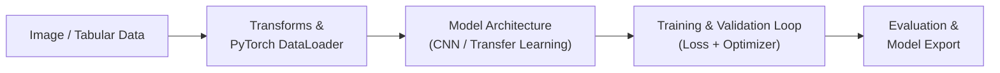

<div align="center">

# 🔥 PyTorch Deep Learning & Computer Vision Lab

### *Neural Network Foundations, Vision Milestones & Model Training Pipelines in PyTorch*

[](https://www.python.org/)
[](https://pytorch.org/)
[](#)
[](https://jupyter.org/)

</div>

---

## 📌 Overview

A structured repository of **PyTorch** deep learning experiments, computer vision classification milestones, and end-to-end model training pipelines — bridging foundational tensor operations with practical vision deployment workflows.

---

## 🧠 Training Workflow



---

## 📂 Notebooks & Modules

| Notebook / Directory | Focus Area | Description |
| :--- | :--- | :--- |
| **`MileStoneProject-food-vision.ipynb`** | Computer Vision | Multi-class food image classification milestone project using PyTorch vision models. |
| **`MileStoneProject-emotion-classification.ipynb`** | Computer Vision | Facial emotion classification deep learning pipeline and evaluation. |
| **`Mobile_App_Fruit_Model_Pipeline✅.ipynb`** | Applied CV Pipeline | End-to-end fruit classification model training pipeline built for mobile integration. |
| **`Linear_Regression_Model.ipynb`** | PyTorch Fundamentals | Foundational neural network training loop, autograd, and optimization from scratch. |
| **`PyTorch-Lesson/`** | Core Labs | Structured practice notebooks covering tensors, workflows, and PyTorch building blocks. |

---

## 🚀 Getting Started

```bash
git clone https://github.com/blgnr1/pytorch-deep-learning-lab.git
cd pytorch-deep-learning-lab

python -m venv .venv
# Windows: .venv\Scripts\activate  |  Linux/macOS: source .venv/bin/activate
pip install torch torchvision matplotlib numpy jupyter
jupyter notebook
```

---

<div align="center">
  <sub>Built by <b>Kerem Bilginer</b> · <a href="https://www.linkedin.com/in/kerem-bilginer/">LinkedIn</a> · <a href="https://www.blgnr1.com/">Portfolio</a></sub>
</div>
